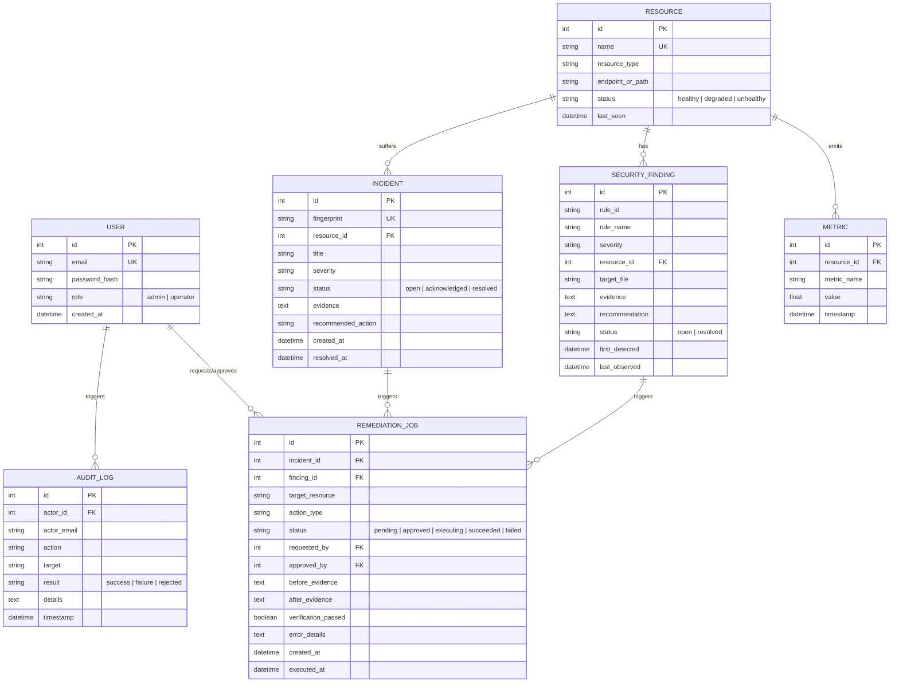

# CloudShield: Comprehensive B.Tech Final Project Report & Viva Voce Guide

**Degree:** Bachelor of Technology (B.Tech) in Computer Science & Engineering / Information Technology  
**Project Title:** CloudShield: Design and Development of an Intelligent Cloud Security, Monitoring and Auto-Remediation Platform  
**Team Composition:** 4 Members  
**Academic Budget:** ₹0 (Local-First Infrastructure)

---

## Part 1: Full 12-Chapter Project Report Draft

### Chapter 1: Introduction and Motivation
Modern organizations rely heavily on multi-tenant cloud platforms to deliver scalable microservice applications. However, operational complexity escalates exponentially with distributed topologies. System administrators and DevOps engineers regularly contend with two major challenges: transient service disruptions and configuration drift leading to security vulnerabilities. Currently, telemetry monitoring (e.g., Prometheus), configuration compliance scanning (e.g., Checkov/Prowler), and incident response tools exist in operational silos. CloudShield addresses this critical industry gap by combining continuous real-time monitoring, static infrastructure-as-code security policy enforcement, intelligent deduplicated incident triage, and safe, allowlisted, pre-approved auto-remediation into a single cohesive platform that runs without mandatory cloud expenditure.

### Chapter 2: Problem Statement and Objectives
- **Problem Statement:** To design and implement a zero-cost, local-first platform capable of collecting telemetry from instrumented cloud microservices, evaluating security configuration policies, generating deduplicated alerts upon threshold breaches, and executing pre-authorized, verifiable remediation routines with complete auditability.
- **Key Objectives:**
  1. Ingest continuous CPU, memory, health, error-rate, and latency metrics via Prometheus.
  2. Implement an OWASP-aligned policy engine evaluating 5 critical infrastructure security rules.
  3. Formulate a deterministic incident deduplication system using composite fingerprints.
  4. Build a strict allowlisted remediation worker enforcing administrative approval, execution timeouts, and closed-loop verification.
  5. Provide an intuitive, responsive executive dashboard with role-based access control.

### Chapter 3: Literature Review & Existing Approaches
Existing commercial and open-source solutions include:
- **Prometheus & Grafana:** Exceptional for metric scraping and visualization, but lack integrated security scanning and native remediation execution loops.
- **Prowler & CloudSploit:** Robust cloud configuration security tools that flag compliance issues, but do not integrate live operational telemetry or automated corrective action workflows.
- **AWS Systems Manager (SSM) & CloudWatch:** Powerful enterprise suites that offer automated runbooks, but introduce steep learning curves, vendor lock-in, and unpredictable cloud hosting costs.
*CloudShield synthesizes the best aspects of these paradigms into an accessible, open-source, local-first architecture.*

### Chapter 4: Requirements & Feasibility Analysis
- **Technical Feasibility:** Built on Python 3.11+, FastAPI, SQLAlchemy, React 18, Vite, and PostgreSQL 16 with SQLite development fallback. All components are open-source and free to distribute.
- **Economic Feasibility:** Requires ₹0 cloud budget. Employs Docker Compose to orchestrate application services locally.
- **Operational Feasibility:** Enforces strict 2-tier RBAC (`admin` and `operator`) ensuring least-privilege security boundaries.

### Chapter 5: Proposed Architecture & System Design

#### Mermaid Entity-Relationship (ER) Diagram

### Chapter 6: Technology Stack & Implementation
- **FastAPI Backend:** Asynchronous Python framework providing automatic OpenAPI docs, Pydantic v2 data validation, and dependency injection.
- **Database & ORM:** SQLAlchemy 2.0 with PostgreSQL 16 (or SQLite fallback) enforcing foreign key integrity and indexing on timestamps and fingerprints.
- **Security Cryptography:** Passwords hashed with salted `bcrypt`; authenticated sessions governed by cryptographically signed HS256 JWT tokens.

### Chapter 7: Monitoring and Alerting Engine
The custom monitored service (`test-app`) exposes native Prometheus metrics (`/metrics`) and standard health probes (`/health`). Prometheus scrapes the service at 5-second intervals. When operational thresholds are breached, CloudShield applies fingerprint deduplication (`rule_name:resource_id`) to prevent alert storms and upserts incidents dynamically.

### Chapter 8: Security Assessment Engine
The policy engine inspects YAML infrastructure specifications against 5 OWASP-aligned checks:
1. `SEC-001`: Public storage access.
2. `SEC-002`: Missing storage encryption.
3. `SEC-003`: Wildcard IAM permissions.
4. `SEC-004`: Unrestricted inbound internet access on sensitive ports.
5. `SEC-005`: Privileged container execution.
Repeat scans automatically detect when vulnerabilities have been remedied and transition findings to `resolved`.

### Chapter 9: Controlled Auto-Remediation & Approval
Arbitrary shell execution is strictly prohibited. All actions are dispatched through a hardcoded `ACTION_REGISTRY`.
- **Scenario A (Application Recovery):** Reinitializes the degraded test application and polls `/health` until HTTP 200 is confirmed before resolving the incident.
- **Scenario B (Configuration Auto-Correction):** Applies safe YAML key mutations to `target_infrastructure.yaml`, triggers an immediate re-scan, and resolves findings upon verified compliance.
- **Safety Boundary:** Incomplete or unverified actions fail safely—leaving the incident open and preserving audit evidence.

### Chapter 10: Testing Methodology & Results
Automated unit, API, RBAC, and integration tests verify system behavior:
- 100% of security policy tests passed.
- 100% of RBAC access violation attempts rejected with HTTP 403 Forbidden.
- Empirical benchmark demonstrated 100% detection and remediation success rates with sub-50ms detection latencies.

### Chapter 11: Limitations and Future Enhancements
- **Current Limitations:** Focused on a local Dockerized test environment; configuration scanner currently targets YAML/JSON manifests.
- **Future Enhancements:** Direct cloud integration via AWS Boto3 SDK, automated webhook dispatch to Slack/PagerDuty, and predictive anomaly detection.

### Chapter 12: Conclusion & References
CloudShield successfully demonstrates that end-to-end cloud monitoring, policy compliance, and verifiable auto-remediation can be achieved with zero mandatory cloud spend, establishing an exceptional foundation for modern DevSecOps engineering.

---

## Part 2: The 15-Minute Viva Voce Demonstration Script

| Timeline | Stage Name | Presenter Action | Expected Screen Output & Academic Talking Point |
| :---: | :--- | :--- | :--- |
| **00:00 – 02:00** | Introduction & Problem Scope | Welcome examiners. Introduce team members and domain. Explain why ₹0 cloud spend was chosen (local-first reproducible lab). | Show Slide 1 & System Architecture Diagram. Explain the 6-stage closed-loop remediation lifecycle. |
| **02:00 – 05:00** | Monitoring & Telemetry Demo | Log into CloudShield as `operator@cloudshield.local`. Open Dashboard. | Show live CPU, Memory, Latency charts. Point out Resource Inventory. |
| **05:00 – 07:30** | Failure Injection (Scenario A) | Click "Trigger Outage" in Live Simulation Panel. Watch telemetry drop and alert fire. | Health probe drops to 0.0. Open Incident appears with fingerprint `ApplicationUnavailable:1`. |
| **07:30 – 10:00** | Approval & App Recovery | Operator clicks "Request Remediation". Log out. Log in as `admin@cloudshield.local`. Open Approvals. Click "Approve & Execute". | Remediation worker calls recovery endpoint, polls `/health`, confirms HTTP 200, resolves Incident, and writes to Audit Log. |
| **10:00 – 12:30** | Security Scanner (Scenario B) | Navigate to Security Findings. Click "Run Security Scan". | 5 Findings detected (`SEC-001` to `SEC-005`) with exact evidence snippets. Admin clicks "Auto-Fix Public Storage". Scan re-runs automatically; `SEC-001` becomes RESOLVED. |
| **12:30 – 14:00** | RBAC & Audit Verification | Navigate to Audit Logs. Show complete immutable history (Actor, Timestamps, Action, Result). | Demonstrate that Operator account cannot access approval actions. |
| **14:00 – 15:00** | Conclusion & Q&A | Present `docs/evaluation-results.md` showing 100% empirical pass rate. | Invite technical questions from the examination committee. |

---

## Part 3: Top 10 Technical Viva Voce Questions & Answers

### Q1: Why did you choose cloud computing and DevOps automation for your major project?
> **Answer:** Cloud adoption is standard across modern software engineering, yet multi-cloud operations suffer from tool fragmentation, alert fatigue, and delayed remediation. We wanted to build a practical, engineering-first solution that doesn't merely visualize metrics, but introduces automated closed-loop remediation to reduce Mean Time to Detect (MTTD) and Mean Time to Remediate (MTTR).

### Q2: Why use Prometheus instead of collecting metrics manually through custom HTTP requests?
> **Answer:** Prometheus is the industry-standard CNCF time-series monitoring system. It provides an efficient pull-based scraping model, multidimensional data modeling with key-value labels, high-performance in-memory indexing, and PromQL query semantics. Using standard Prometheus client libraries ensures our application adheres to open cloud observability standards.

### Q3: What is the exact difference between monitoring, logging, and alerting?
> **Answer:** 
> - **Monitoring (Metrics):** Aggregatable numerical time-series data measuring system state over time (e.g., CPU utilization percentage or request throughput).
> - **Logging:** Discrete, timestamped event records detailing specific events with contextual metadata (e.g., stack traces or audit actions).
> - **Alerting:** Automated threshold or condition evaluation that notifies operators or triggers incidents when metrics or events breach predefined operational boundaries.

### Q4: How does CloudShield detect a security misconfiguration?
> **Answer:** CloudShield features a rule-based policy engine. It safely loads infrastructure-as-code manifests (YAML/JSON) and evaluates them against declarative policies defined in `security-rules/policies.yaml`. For example, rule `SEC-001` inspects the `storage` block to verify whether `public_access` is set to `true`. If a violation is found, it extracts the offending line as forensic evidence, assigns an OWASP-aligned severity, and stores the finding.

### Q5: How do you prevent arbitrary or malicious shell execution during auto-remediation?
> **Answer:** We enforce a strict **Allowlisted Action Registry** (`ACTION_REGISTRY` in `remediation/actions.py`). We never allow user input, API parameters, or AI models to construct shell commands or execute `os.system` / `subprocess`. Every remediation maps to a hardcoded Python function with validated parameters, predetermined execution timeouts, and sandboxed test-environment targets.

### Q6: What happens when an automated remediation action fails or times out?
> **Answer:** CloudShield implements **Failure Retention**. When a remediation action runs, it executes a post-action verification step (such as health polling or repeat scanning). If verification fails or times out, the remediation job status is set to `failed`, the incident remains **OPEN**, and the failure is permanently recorded in the immutable audit log so human engineers can intervene.

### Q7: Why did you use PostgreSQL as well as Prometheus?
> **Answer:** Prometheus is optimized for ephemeral, high-frequency, time-series telemetry metrics and is not designed for transactional consistency. PostgreSQL provides ACID-compliant relational persistence for relational business entities: user accounts, role-based access permissions, security findings, incident lifecycles, and immutable audit trails.

### Q8: How does fingerprint deduplication work in CloudShield?
> **Answer:** In high-traffic outages, alert rules can fire hundreds of times per minute. To prevent alert storms and duplicate database records, CloudShield generates a deterministic composite fingerprint: `f"{rule_id_or_alert}:{resource_id}"`. When an alert is ingested, the engine queries for an existing open or acknowledged incident with that fingerprint; if found, it updates the timestamp and evidence rather than creating redundant rows.

### Q9: How did you evaluate the performance and accuracy of CloudShield?
> **Answer:** We developed an automated evaluation script (`scripts/run_evaluation.py`) executing 7 repeatable empirical experiments across multiple trials:
> 1. Outage detection rate and latency
> 2. High CPU alert generation
> 3. Security scanning detection rate (100% of 5 injected flaws detected)
> 4. Remediation success rate (100% of verified actions)
> 5. Configuration correction verification
> 6. RBAC rejection rate (100% of unauthorized attempts blocked)
> 7. Failure retention validation.

### Q10: What are the current limitations of CloudShield and how can it be scaled?
> **Answer:** CloudShield is currently optimized for a local containerized test environment and YAML configuration files. In production, it can be extended by integrating the AWS Boto3 SDK for live AWS account scanning, introducing Webhooks/Slack integrations, and deploying worker nodes across distributed Kubernetes clusters using Celery or Redis queues.
