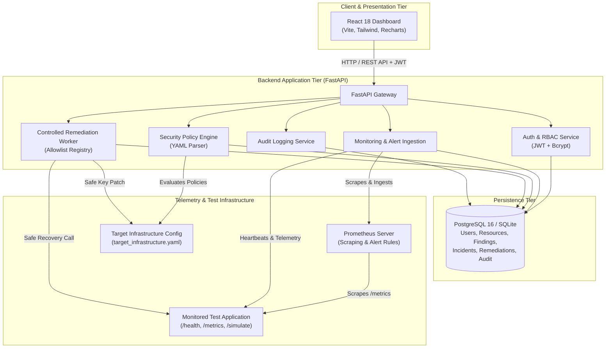
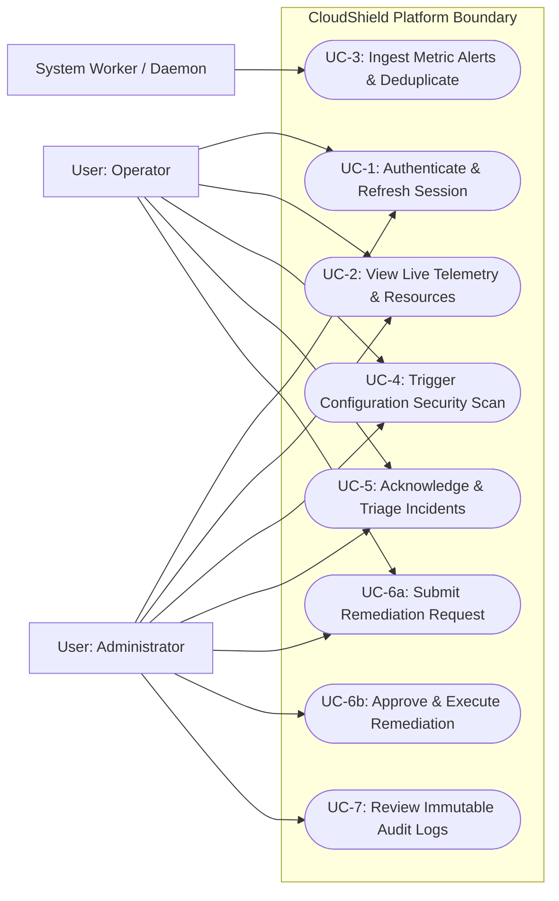
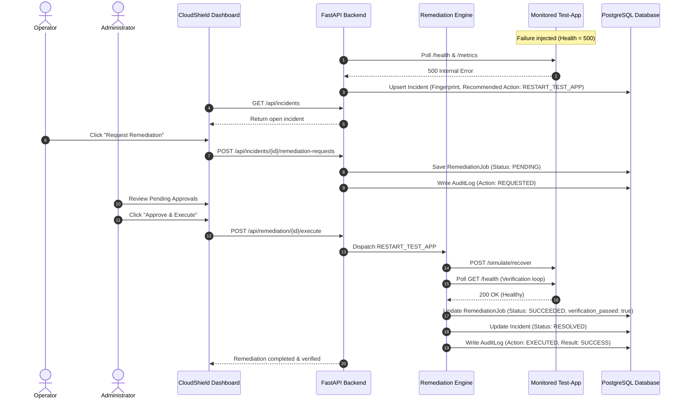
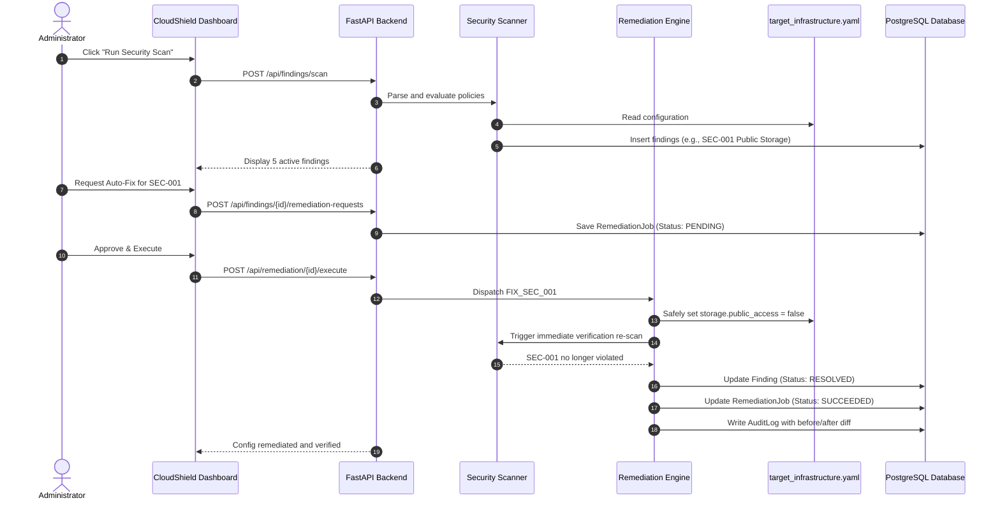

# CloudShield: Architecture, Use Cases & Data Flow Specifications

## 1. System Architecture Diagram

---

## 2. Use Case Diagram

---

## 3. End-to-End Remediation Sequence Diagram (Scenario A: App Recovery)

---

## 4. End-to-End Configuration Correction Sequence Diagram (Scenario B: Config Remediation)

